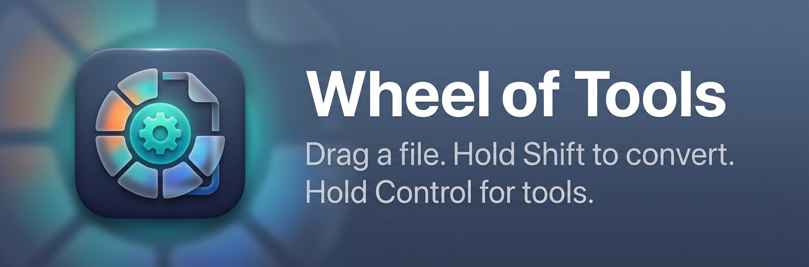

<p align="center">
  
</p>

# Wheel of Tools

A macOS menu-bar app. Drag a file in Finder, hold a modifier key, and a glass wheel appears under your
pointer. Drop the file on a button to convert it or run a tool. The result is saved next to the original.
Everything runs on your Mac; nothing is uploaded.

| While dragging a file | Opens |
| --- | --- |
| **⇧ Shift** | Convert wheel (output formats for that file type) |
| **⌃ Control** or **⌥⇧** | Tools wheel (compress, crop, metadata, …) |

## Features

**Convert**

| Input | Outputs |
| --- | --- |
| Images (JPG, PNG, HEIC, WebP, TIFF, AVIF, BMP, GIF, SVG) | JPG, PNG, HEIC, WebP, TIFF, AVIF, BMP, GIF, PDF |
| PDF | PNG, JPG, TXT, DOCX |
| Video (MP4, MOV, MKV, AVI, WMV, WebM) | MP4, MOV, MKV, AVI, WMV, WebM, GIF, MP3 |
| Audio (MP3, M4A, WAV, FLAC, OGG, Opus, AIFF) | MP3, M4A, WAV, FLAC, OGG, Opus, AIFF |
| Word / Pages (DOCX, DOC, RTF, ODT, Pages) | PDF, DOCX, Pages, RTF, TXT |
| Excel / Numbers / CSV | PDF, XLSX, Numbers, CSV |
| PowerPoint / Keynote | PDF, PPTX, Keynote, PNG (one image per slide) |
| TXT, Markdown, HTML | PDF, TXT, DOCX, Pages, ZIP |
| SRT / VTT subtitles | SRT, VTT |
| Anything | ZIP, TAR, GZ |

**Tools** (depend on file type)

- Images: Compress, Crop, Edit (brightness / contrast / saturation), Annotate (pen, box), Background
  (replace the background behind the main subject), Redact, Metadata, Remove Metadata, Read QR
- PDF: Compress, Merge, Split, Metadata, Remove Metadata
- Video: Compress, Snapshot, Metadata, Remove Metadata
- Audio: Compress, Normalize, Metadata, Remove Metadata
- Dropping several files runs the job on all of them. Merge turns images and PDFs into one PDF.

Output files are never overwritten: `photo.webp`, then `photo 2.webp`, and so on.

## Requirements

- macOS 14 or later (the glass look uses Liquid Glass on macOS 26+ and falls back to a blur material on older versions)
- Xcode command-line tools / Swift 5.9+ to build
- Homebrew tools, used as backends:

  ```sh
  brew install ffmpeg imagemagick exiftool pandoc
  ```
- Pages, Numbers and Keynote (free from the App Store) for Word / Excel / PowerPoint / iWork conversions.
  macOS asks once to let Wheel of Tools control them (System Settings → Privacy & Security → Automation).

## Install (download)

1. Download `WheelOfTools-<version>.dmg` from the **Releases** page and open it.
2. Drag **Wheel of Tools** onto the **Applications** folder in the window that appears.
   (A `.zip` is also provided; unzip it and move the app to Applications yourself.)
3. The app is not notarized, so macOS blocks the first launch. Either right-click the app → **Open** →
   **Open**, or run: `xattr -dr com.apple.quarantine "/Applications/Wheel of Tools.app"`
4. Install the tools you want (the Settings window shows what is missing and copies the command for you):

   ```sh
   brew install ffmpeg imagemagick exiftool pandoc
   ```

Without them the wheel still works for editing images, PDF tools and macOS-native conversions. See
*Requirements* below for which feature needs which tool.

## Build and install

```sh
scripts/make_app.sh      # builds a release app, ad-hoc signs it, installs to /Applications (or ~/Applications)
open "/Applications/Wheel of Tools.app"
```

If you launch the app from somewhere else (Downloads, a disk image), it offers to move itself to
Applications. The app lives in the menu bar (dial icon). Open it again from Finder or Spotlight, or choose
**Settings…** (⌘,), to change the wheel size, preview it, or turn on Open at login.

## Publishing a release

```sh
scripts/package_release.sh 1.2          # -> build/WheelOfTools-1.2.dmg and .zip (+ SHA-256)
gh release create v1.2 build/WheelOfTools-1.2.dmg build/WheelOfTools-1.2.zip --title "Wheel of Tools 1.2" --notes "See README for install steps."
```

## Tests

```sh
scripts/test_core.sh     # 80+ headless checks: every converter, every tool, security regressions,
                         # plus the editor (crop/redact/annotate/adjust/background) and QR reading
```

`scripts/e2e/` has helpers for driving a real Finder drag with synthesized events. They need Accessibility
permission for your terminal. See `scripts/e2e/README.md`.

## Layout

```
Sources/WheelCore/      conversion and tool logic (no UI, testable headless)
Sources/WheelOfTools/   menu-bar app: drag detection, wheel, editor, settings
Sources/wot-cli/        command-line driver used by the tests
scripts/                make_app.sh, test_core.sh, e2e helpers
```

CLI examples: `wot-cli convert photo.jpg webp`, `wot-cli tool compress video.mp4`.

## How it works

A 60 Hz timer watches for a left-button drag whose drag pasteboard holds file URLs. This needs no
Accessibility permission. Holding a modifier shows a borderless, non-activating panel at the pointer so the
Finder drag keeps focus. The panel is a drop target, and the segment under the drop point picks the action.

## Security notes

- Fully local. No network access, no analytics. A small activity log is written to
  `~/Library/Logs/WheelOfTools.log` (file names and results only).
- Backends are run with argument arrays, never through a shell string. The one `sh -c` (gzip) takes the
  paths as positional arguments.
- ImageMagick input is forced to the format implied by the file extension, so a file that merely
  *contains* MVG/MSL/SVG script is not auto-detected as one. ffmpeg is limited to the `file` protocol and
  pandoc runs with `--sandbox`.
- Backends are looked up in `/opt/homebrew/bin`, `/usr/local/bin`, `/usr/bin`, `/bin`. Keep those
  directories writable only by you.
- The app is not sandboxed (it must run the tools above) and is only ad-hoc signed. For distribution, sign
  with a Developer ID and notarize. Debug-only hooks (`WOT_SELFTEST`, `WOT_RENDER`, `WOT_PREVIEW`) are
  compiled out of release builds.
- Don't open files you don't trust with ffmpeg / ImageMagick / pandoc backends that are out of date; keep
  Homebrew packages updated.

## Known limits

- RAR, SVG output, video trim / speed / join, audio bleep, exact-file-size compression and collages are not
  implemented yet.
- OGG output uses ffmpeg's built-in Vorbis encoder (no `libvorbis` in the Homebrew build).
- Office conversions go through Pages / Numbers / Keynote, so complex Word or PowerPoint layouts may shift.
- Spreadsheet CSV export includes the Numbers table name as a first row.

## License

[MIT](LICENSE) © 2026 Louis Flores. The helper programs it calls (ffmpeg, ImageMagick, exiftool, pandoc)
are separate projects with their own licenses; they are installed by the user, not bundled.
